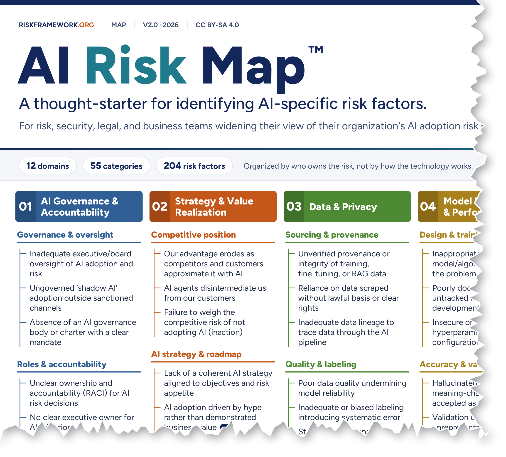

# AI Risk Map™

*Detail of the upper-left. The full poster is [`AI-Risk-Map.pdf`](AI-Risk-Map.pdf) (print-ready) or [`.png`](AI-Risk-Map.png).*

**A single-page visual reference built to improve the quality of AI risk conversations.**

Most teams naturally gravitate toward familiar concerns like hallucinations, prompt injection, and bias. But AI risk extends well beyond the usual talking points. The AI Risk Map helps teams quickly widen their perspective, surface blind spots, and identify overlooked risks before moving into deeper analysis.

It is not a risk library or exhaustive catalog. It is a practical tool designed to spark better conversations and uncover overlooked risks.

12 domains · 55 categories · 204 risk factors · one page.

**Using an earlier version?** v2.0 adds a tenth column, *Condition type*, and changes the meaning of several factors. If you parse the CSV or mapped controls to an earlier version, see [What changed in v2.0](#what-changed-in-v20) first.

---

## What's in this repository

| File | What it is | Use it when |
|---|---|---|
| `AI-Risk-Map.pdf` | The poster. Print-ready at 48×36 in (ARCH E). | You want it on the wall, or in the workshop. |
| `AI-Risk-Map.png` / `.svg` | Same poster, raster and vector. | Slides, intranet pages, editing the graphic. |
| `AI-Risk-Map-Taxonomy.xlsx` | The workbook: every factor with its ID, source provenance, cross-references, scope decisions, and version history. | You want to see *why* something is or isn't on the map. |
| `AI-Risk-Map.md` | The full corpus in one markdown file — factors plus all the reasoning, with a self-contained header. | You want to load the map into your own AI assistant and ask it questions. **Start here if you do that.** |
| `AI-Risk-Map.csv` | Flat table, one row per factor, ten-column schema (column J added in v2.0). | You are mapping controls, tools, or systems to the map programmatically. |
| `AI-Risk-Map-preview.png` | Cropped detail used at the top of this page. | Social posts, slides — a readable teaser. |
| `LICENSE` | CC BY-SA 4.0 legal text. | |

## How the map is organized

**By who owns the risk, not by how the technology works.** The twelve domains are enterprise functions — governance, strategy, data, model development, security, safety, operations, legal, third-party, workforce, financial, and autonomous action. A CFO, a general counsel, and a security lead can each open it and find themselves in it.

Three tiers: Domain → Category → Risk factor. Each risk factor is a condition that contributes to risk: a cause, a missing or weak safeguard, or an amplifier (see Condition type below). It is not a scored risk. A factor may imply a missing or deficient control condition, but it is never phrased as a control to implement.

**Scope.** The map covers risk arising from *your organization's own adoption of AI*. Risk arising from *others' adversarial or malicious use of AI against you* — AI-enabled fraud, deepfake impersonation, adversarial automation — is deliberately out of scope. That risk is real; it belongs on your threat register, not on an adoption map. The effect of competitors' and customers' AI on the value of your own strategy is in scope. The scope decisions sheet in the workbook records this and every other deliberate exclusion.

**What gets in.** The map does not list every risk that applies to managing an AI system. It lists the risks that AI *introduces*, or that AI *amplifies* in a specific and nameable way. Generic IT, cyber, and vendor risk that exists identically without AI stays off; that one constraint is what keeps the map finite. A candidate earns a place by clearing any one of three gates:

| Gate | Test |
|---|---|
| **AI-specific** | Remove AI and the risk vanishes. |
| **Management delta** | The risk is not new, but the way it must be managed is. The delta has to be specific — *"agent-framework sprawl outpacing credential governance"* qualifies; *"cyber risk went up"* does not. |
| **Corroboration** | Two or more independent AI standards name it. |

Passing a gate is admission, not priority. When there were more good candidates than the page could hold, the tiebreak was how likely a competent team is to overlook the factor — because the poster exists to surface what gets missed, not to restate what everyone already tracks.

**Split pairs.** Some risks are the same loss seen from two owners' columns, such as a compromised model component, which Security sees as an attack on artifacts and Third-Party sees as a bad dependency. The map routes each side to its owner and cross-references them. They are split on purpose. The test is one question: would assessing both factors as separate scenarios count the same loss twice? If so, they are a split pair. Check the Cross-references sheet before reporting one as a duplicate.

**Cross-reference markers.** `»n` on the poster (`→n` in the CSV) means this factor is one side of a split pair whose other side is owned by domain *n*. The marker is used for nothing else, and both sides of every pair are marked. The workbook's Cross-references sheet records two kinds of relationship:

| Kind | What it means | On the poster | When counting |
|---|---|---|---|
| **Split pair** | The same loss, seen from two owners' columns | `»n` | Count once |
| **See-also pointer** | A different risk worth reading alongside: a more general factor, the mirror image of the same behavior, the same kind of loss arising a different way, a parallel instance, or a missing safeguard and the risk it protects against. One-way. | Not marked; workbook and markdown only | Count both |

**Condition type.** Every factor says how it enters a risk scenario. The map holds AI-specific causes, AI-specific safeguard gaps, and AI-specific amplifiers:

| Condition type | What it is | Test |
|---|---|---|
| **Cause** | The first thing that goes wrong | Fix it, and the loss never starts |
| **Safeguard gap** | A missing or weak control. A condition on the scenarios it protects, never a scenario of its own | Fix it, and the first failure still happens, but a later step is stopped or the loss is softened |
| **Amplifier** | Makes losses happen more often, spread further, or land harder, without causing them | It changes how often or how badly, not whether |
| **Outcome** | Names the loss event itself. A few factors still do; each is a candidate for rewording to its cause | — |

Use it to filter: *"show me the safeguard gaps"* for a control mapping, *"show me the causes"* to start a scenario.

## How to use it

**In a workshop.** Put it on the wall. Walk the room through it domain by domain and ask: which of these have we not discussed? The columns furthest from the room's expertise are where the value is.

**With your AI assistant.** Load `AI-Risk-Map.md` into your tool of choice. Its header includes a copy-paste instruction block that keeps the assistant grounded in the map — answer only from this document, cite the factor ID, say plainly when something is not covered. Then ask things like *"We're deploying a customer-facing agent. Walk me through the factors we should discuss, domain by domain."*

**Programmatically.** Use the CSV. Every factor has a permanent identifier (`AIRM-001` … `AIRM-205`). IDs are flat, opaque, and stable across versions. Wording is not stable; cite the ID.

Columns A–I are frozen at v1.0, and column J was added in v2.0. Adding, removing, or reordering a column is a major version. The contract:

| Col | Name | Notes |
|---|---|---|
| A | `ID` | `AIRM-nnn`. Never reused, never renumbered. Retired factors keep a tombstone row. |
| B | `Domain` | Tier 1 |
| C | `Category` | Tier 2 |
| D | `Risk factor — full description (L3)` | Authoritative wording. May change; cite the ID. |
| E | `Poster label` | Short form used on the poster |
| F | `Source(s)` | Semicolon-separated; notation in the workbook's Source key |
| G | `X-ref` | `→n` = one side of a split pair; the other side is owned by domain n (the poster's `»n`). Split pairs only. |
| H | `Status` | `active` / `retired` |
| I | `Superseded by` | Surviving ID after a merge |
| J | `Condition type` | `cause`, `safeguard gap`, `amplifier`, or `outcome`; more than one is separated by `; `. Blank on retired rows. Adding a value is a minor version; renaming or removing one is major. |

The workbook's **Cross-references** sheet is authoritative. Part 1 lists each split pair with the factor IDs on both sides; Part 2 lists each see-also pointer from one ID to another. Use the sheet, not the `X-ref` column, to count. Factor-level changes between versions are on the **Change log** sheet.

## What changed in v2.0

v2.0 is a major version because the rules for risk factors changed, and the CSV gained a column. Identifiers and file names are unchanged, and nothing you cited has disappeared. The full list is on the workbook's **Change log** sheet.

**New to leverage**

- **Condition type** (column J). Filter the map by how a factor enters a scenario: 122 causes, 68 safeguard gaps, 10 amplifiers, 4 outcomes. See [How the map is organized](#how-the-map-is-organized).
- **Eight factors.** Customers and partners feeding our data into their AI, with no terms or visibility (`AIRM-198`); no guardrails on what customer-facing AI says in our name (`AIRM-199`); no way to find and remediate everyone a flawed AI decision affected (`AIRM-200`); no tested off-switch or fallback for a misbehaving AI feature (`AIRM-201`); AI making false statements about real people or organizations (`AIRM-202`); agents that rewrite their own instructions or tools (`AIRM-203`); fear-driven AI bans that push use into the shadows (`AIRM-204`); untrusted content treated as instructions (`AIRM-205`).
- **Wider factors.** Several now cover more: tested rollback (`AIRM-120`), data integrity as well as provenance (`AIRM-030`), artifact integrity as well as lineage (`AIRM-189`), runtime tool containment (`AIRM-107`), usage limits on endpoints (`AIRM-082`), fairness testing (`AIRM-054`), biased outcomes in monitoring (`AIRM-108`), meaning-changing summaries (`AIRM-052`), and reasoning or insight extraction (`AIRM-068`).
- **Clearer rules for factors.** Wording stops at the condition; the loss belongs to the scenario. Safeguard gaps name the objective, not a technique. A list in parentheses is illustrative and starts with *e.g.*

**Check against earlier work**

- **The CSV has ten columns.** If your parser checks the column count or reads by position past column I, update it. Columns A–I are unchanged.
- **Six factors changed meaning.** If you mapped controls or scenarios to these, check them:
  - `AIRM-039` now names the missing output guardrail. The disclosure itself is the scenario's outcome; its causes include `AIRM-041`, `047`, `085`, and `182`.
  - `AIRM-126` now covers AI-specific obligations generally, not only high-risk ones, and names the obligation not identified or built in, rather than the breach.
  - `AIRM-131` now names AI output that reproduces others' copyrighted work or trademarks, not the claims that follow.
  - `AIRM-164` now names uncontrolled AI consumption, not runaway cost.
  - `AIRM-186` now names agents able to take irreversible actions. Unauthorized means remain `AIRM-174`.
  - `AIRM-130` and `AIRM-144` now name how AI changes liability and accountability, rather than the liability itself.
- **One fewer split pair.** The intellectual-property pair (`AIRM-042`, `043` / `131`) is now a see-also, because 131 names output and 042/043 name training inputs. Five pairs remain (11 marked factors). If you counted that pair once, count both now.
- **Sources.** OWASP Top 10 for LLM Applications locators moved to the 2026 edition, which renumbered most entries. The Change log lists every factor affected.
- **Wording.** Other rewords clarify the same condition, or mark illustrative lists with *e.g.* Cite by ID and these need no action.

## Frequently asked

**Is this a control framework? Where are the controls?**
No. It is not a control standard or a control library, and that is deliberate: it is what keeps a one-page artifact from becoming a several-hundred-row catalog. Many factors do imply a missing or deficient control condition. *"Inadequate access controls and usage limits on serving endpoints and inference APIs"* is one. That is because a control gap is a condition that contributes to risk. What the map does not do is tell you which control closes the gap. One factor may call for several controls, and one control may address several factors. The stable `AIRM` identifiers exist precisely so you can map *your* control catalog, tool inventory, or architecture to it. That has already been done once: a separate project used the map as the validation standard for a 264-control catalog (all 247 controls in the CSA AI Controls Matrix plus 17 extensions), and the mapping is what showed the owner-based structure partitions cleanly between "security's job" and "someone else's job." If you build a controls mapping, the share-alike license means others can benefit from it too.

**Why isn't *X* on the map?**
Open the workbook's **Scope decisions** sheet first. It records what was deliberately excluded and why, what was challenged and kept, and what was considered and not added. If *X* isn't there, open an issue.

**Can I score or rank these?**
Not with what is here. Position, order, and ID number carry no meaning about likelihood or severity. A rare catastrophic factor sits beside a common minor one. Scope a factor into a proper risk scenario before you quantify it.

**Can I filter, sort, or group the factors?**
Yes. The workbook's Taxonomy sheet and the CSV carry three ways to slice the map, and they combine:

- **By owner:** Domain and Category (columns B and C). This is how the poster is laid out, so each function can find its own column.
- **By role in a risk scenario:** Condition type (column J). Filter for *cause* to find where scenarios start, *safeguard gap* when mapping controls or checking coverage, and *amplifier* for what makes losses more frequent or more severe. A few factors are *outcome*. See [How the map is organized](#how-the-map-is-organized).
- **By source:** Source(s) (column F), for example every factor citing the EU AI Act or OWASP.

Combined, they answer questions like *"which safeguard gaps does Operations own?"* or *"which causes come from the OWASP Top 10?"* The map does not sort by likelihood or severity (see *Can I score or rank these?*). Relationships between factors are on the workbook's Cross-references sheet.

**Where do the factors come from?**
Every factor carries a source citation in the workbook and markdown. Sources span regulation (EU AI Act, Colorado), standards (NIST AI RMF, GenAI Profile, and AI 100-2, ISO/IEC 42001), threat frameworks (OWASP LLM / Agentic / AISVS, MITRE ATLAS, Databricks DASF), internal-control and financial-services guidance (COSO, CRI FS-AI-RMF, MAS, SR 11-7), practitioner frameworks (CSA AICM, Databricks AI Governance Framework), and academic taxonomies (MIT AI Risk Repository, International AI Safety Report, Weidinger, Shelby). Every one of the 204 factors is traceable. 75 carry the author's own framing of a risk a cited framework names (`…; Original`). 36 are named by no reviewed framework at all; those cluster in Strategy and Workforce, which is where the map does work the technical frameworks do not.

**How is it validated?**
Crosswalked against 22 frameworks, regulations, and taxonomies; stress-tested through persona review and named-expert critique; reviewed by external practitioners; used as the validation standard for a separate 264-control catalog built on the CSA AI Controls Matrix; and put through a full citation audit before release in which every source locator was verified against the primary text and every `Original` tag was checked against every cited framework. The workbook's provenance appendix shows how many factors each source anchors.

**How do I cite it?**
> Wheeler, E. (2026). *AI Risk Map* v2.0. Licensed CC BY-SA 4.0. https://github.com/wheels344i-gte/ai-risk-map/releases/tag/v2.0

Cite individual factors by ID: `AIRM-042`. Identifiers are permanent; factor wording can change between versions, so name the version when the exact wording matters.

**How do I link to it?**
File names carry no version number, so links don't break when a new version ships. The current version is stated inside every file (on the poster, on the workbook's Version History sheet, and in the markdown header) and in the [release list](https://github.com/wheels344i-gte/ai-risk-map/releases).

| You want | Link pattern |
|---|---|
| Always the current version (websites, slides, bookmarks) | `https://github.com/wheels344i-gte/ai-risk-map/blob/main/AI-Risk-Map.pdf` |
| One specific version, unchanging (citations, audits) | `https://github.com/wheels344i-gte/ai-risk-map/blob/v2.0/AI-Risk-Map.pdf` |
| The file itself, for tools, scripts, AI assistants, or embedding an image | Replace `blob` with `raw` in either link above |

Replace `AI-Risk-Map.pdf` with any file in the table above. `blob` links open the file on GitHub with a preview and a download button; `raw` links return the file alone. To see what changed between versions, open a file's **History** on GitHub. The CSV and markdown show line-by-line differences, and the PNG and SVG can be compared side by side.

## Proposing changes

Proposals are welcome — **as Issues, not pull requests.** The files in this repository are generated from a single source that is not published here, so a pull request against the workbook, CSV, or markdown cannot be merged; it would be overwritten by the next build. Open an Issue instead. Every proposal is reviewed by the author against the three gates above and the Scope decisions sheet, and accepted changes appear in the next release with a row in the Change log.

A good proposal names the risk as a condition (a cause, a missing or weak safeguard, or an amplifier), not as a control to implement, says which gate it clears, and checks that a neighboring factor does not already own it. Corrections to a citation are especially welcome: quote the source.

## Trademark

AI Risk Map™ is a trademark of Evan Wheeler. The name identifies Evan Wheeler's AI Risk Map.

The license below covers the content. It does not grant permission to use the name in a way that suggests sponsorship, endorsement, or affiliation, or that a modified version is the official release. You may use the name accurately to identify or cite this work. If you adapt the map, identify your version as modified and do not present it as the official AI Risk Map. Using the name to brand a separate product or commercial service, or in any way that may cause confusion, requires separate permission.

## License

© 2026 Evan Wheeler. Licensed under [Creative Commons Attribution-ShareAlike 4.0 International](https://creativecommons.org/licenses/by-sa/4.0/). You may share and adapt this work for any purpose, including commercially, provided you give attribution and license any derivative under the same terms. Full text in `LICENSE`.

Databricks DASF and the Databricks AI Governance Framework are © Databricks, licensed CC BY-SA 4.0. The MIT AI Risk Repository is licensed CC BY 4.0. The structure follows an established convention for one-page enterprise risk maps; that convention is format inspiration only, and no third party contributed AI risk content.
